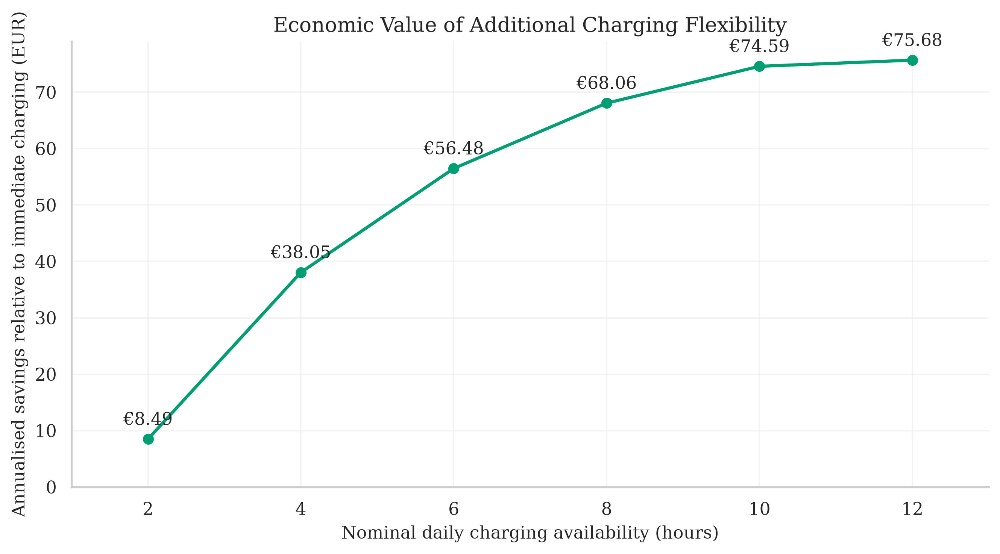
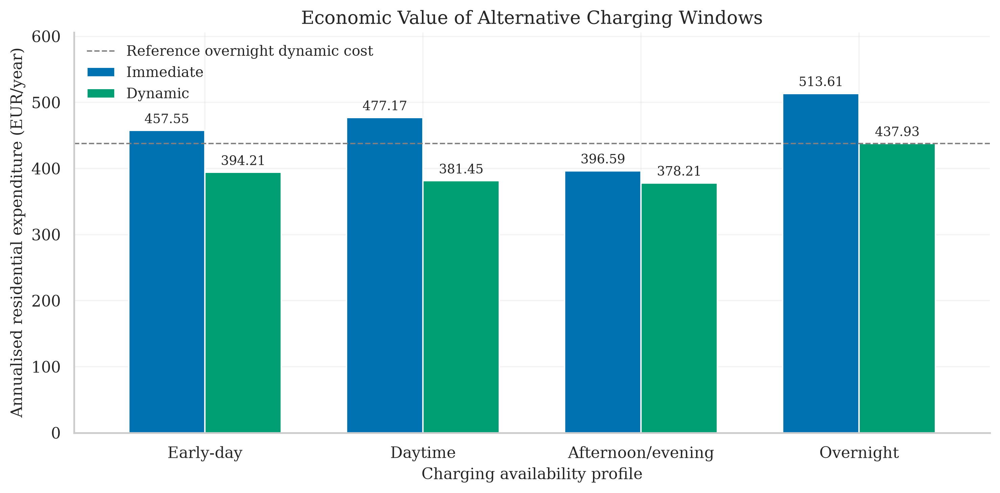

# The Economic Value of Smart EV Charging

*Beyond Electricity Price Volatility: The Economic Value of Timing and Flexibility in Smart EV Charging*


## 1. Research question and scope

**How do the quantity and timing of consumer flexibility, electricity tariff structures and the sophistication of charging optimisation influence the economic value of smart EV charging?**

The project focuses on unidirectional, market-driven charging, one of the three optimisation logics identified by Pons-Seres de Brauwer and Loock (2026). Grid-conscious and prosumer-oriented optimisation inform the reflection but are not explicitly modelled.

The original research question concerned the influence of charging flexibility and practical limits on its benefits. The refined question reflects the completed exploratory and sensitivity analyses. The independent analysis complements, rather than replaces, the course reflection.

## 2. Key findings

| Indicator | Result |
|---|---:|
| Dynamic overnight savings relative to immediate charging | €75.68/year |
| Wholesale / illustrative retail savings | 38.45% / 14.73% |
| Share of dynamic savings captured by a midnight timer | 73.59% |
| Additional value of dynamic optimisation over midnight charging | €19.99/year |
| Share of 12-hour savings captured with 8 hours | 89.93% |
| Additional savings from 10 to 12 hours | €1.09/year |
| Daytime cost advantage over optimised overnight charging | €56.49/year |
| Maximum cost difference among four equally long nominal windows | €59.73/year |
| Independently matched reference LP optima | 364/364 |
| Recorded validation checks passed | 47/47 |

Annual results are annualised from 364 matched sessions at hourly resolution. Sources: Notebooks 02–04 and the reported `reconstructed_savings`, `sensitivity_validation_summary` and `validation_overview` outputs. Results are conditional on the specified assumptions.

The central interpretation is that flexibility has heterogeneous economic value: its duration, timing and optimisation matter. Gross electricity savings must be evaluated against the costs of providing flexibility and implementing charging services.

## 3. Repository structure

```text
Economic-Value-of-Smart-EV-Charging/
├── README.md
├── requirements.txt
├── data/
│   ├── raw/
│   └── processed/
├── literature/
├── notebooks/
│   ├── 00_data_ingestion.ipynb
│   ├── 01_exploratory_analysis.ipynb
│   ├── 02_charging_simulation.ipynb
│   ├── 03_sensitivity_analysis.ipynb
│   └── 04_validation.ipynb
├── outputs/
│   ├── figures/
│   └── tables/
└── Reflection Paper/
```

| Notebook | Purpose |
|---|---|
| 00 | API retrieval, raw data preservation, timezone handling, hourly aggregation and external summary-statistic validation |
| 01 | Annual and seasonal price profiles, daily spreads, minimum-price timing |
| 02 | Reference charging strategies, annualised and seasonal expenditure |
| 03 | Availability duration and timing, tariff, charging power and demand sensitivity |
| 04 | Independent LP benchmark, economic reconstruction, edge cases, temporal checks and native quarter-hourly robustness |

## 4. Reproducibility

From the repository root, create and activate a virtual environment (macOS/Linux):

```bash
python3 -m venv .venv
source .venv/bin/activate
python -m pip install -r requirements.txt
```

Select the `.venv` Python interpreter as the Jupyter kernel in VS Code. Required packages used in the notebooks include `requests`, `pandas`, `numpy`, `matplotlib`, `seaborn`, `scipy` and `ipykernel`. Ensure they are listed in `requirements.txt`. The reported local runs used Python 3.13.17; exact package versions should be recorded from the working environment if not already pinned.

Run notebooks 00–04 in numerical order, each from a fresh kernel using **Restart / Run All**. Notebook 00 requires internet access when retrieving the API data; later notebooks use exported local files. Preserve the original raw response for reproducibility, since subsequent API retrievals may differ. Do not overwrite it unintentionally. Notebook 04 accumulates validation records, so repeated partial execution can duplicate checks.

## 5. Data and processing

| Dimension | Specification |
|---|---|
| Source | Fraunhofer ISE Energy-Charts API |
| External benchmark | Bundesnetzagentur SMARD |
| Market | Germany–Luxembourg day-ahead bidding zone (DE-LU) |
| Observation period | 1 January–31 December 2025, German local time |
| Timezone | Europe/Berlin; unique UTC timestamps for chronological processing |
| Native resolution | Hourly until October; quarter-hourly from 1 October 2025 |
| Main model resolution | Hourly |
| Units | EUR/MWh in source; EUR/kWh in simulation |

Data access: [Energy-Charts API](https://api.energy-charts.info/) and [SMARD](https://www.smard.de/). The original API response is stored as `data/raw/DE_LU_day_ahead_2025.json`. Record the exact request parameters and retrieval timestamp from Notebook 00 or saved metadata; these have not been independently established in this README revision.

The reported API response contained 15,483 observations, including 1 January 2026. Filtering to the 2025 local calendar year retained 15,387 observations: 6,551 hourly and 8,836 quarter-hourly observations. No missing or unexpected timestamps, duplicate UTC timestamps, missing prices or non-finite prices were reported. Four equal-duration quarter-hourly prices were averaged to construct each corresponding hourly price. Conversion to EUR/kWh divides EUR/MWh by 1,000.

The resulting dataset, `data/processed/DE_LU_day_ahead_2025_hourly.csv`, contains 8,760 hourly intervals. Reported summary-statistic comparisons against SMARD:

| Indicator | Calculated / benchmark |
|---|---:|
| Mean price (EUR/MWh) | 89.32 |
| Minimum (EUR/MWh) | -250.32 |
| Maximum (EUR/MWh) | 583.40 |
| Hours above 100 EUR/MWh | 3,494 |
| Hours above 300 EUR/MWh | 40 |
| Negative-price hours (prices rounded to 2 decimals in EUR/MWh) | 573 |

At unrounded precision there were 576 negative-price hours. Rounding to two decimals reproduced the SMARD count; this demonstrates agreement at that precision, not independent confirmation of SMARD's internal rounding procedure. Retain full-precision model prices. Summary-statistic agreement is not a point-by-point external data audit.

## 6. Reference vehicle and charging sessions

| Parameter | Value | Basis |
|---|---:|---|
| Battery capacity | 45 kWh | Lohr et al. (2025), p. 6 |
| Maximum charging power | 11 kW | Lohr et al. (2025), p. 6 |
| Annual residential grid energy | 1,584 kWh | Lohr et al. (2025), p. 11 |
| Charging efficiency | 95% | Adapted from reported 5% charging losses, p. 6 |
| Departure SOC | 60% | Adapted from morning requirement, p. 7 |
| Arrival / departure | 18:00 / 06:00 next day | Hypothetical reference schedule |
| Frequency | One session per day | Own simplification |
| Flat tariff | 30 ct/kWh | Lohr et al. (2025), p. 11 |
| Constant dynamic-tariff component | 20 ct/kWh | Illustrative assumption |

The directly reported residential grid demand of 1,584 kWh supersedes the preliminary protocol estimate of 1,569.6 kWh (2,180 × 72%). Charging losses are not added again to grid demand.

$$E_d=1584/365=4.3397\ \mathrm{kWh}$$

Battery energy replenished is $0.95E_d=4.1227$ kWh. The implied arrival SOC is approximately 50.84%, and scheduled departure SOC is 60%. Minimum charging duration at 11 kW is 23.67 minutes.

The model includes 364 complete sessions arriving 1 January–30 December. It excludes the 31 December arrival because its departure is outside the validated calendar-year dataset. Nominal overnight availability is 12 hours; elapsed availability is 11 hours on the spring clock-change night and 13 hours on the autumn clock-change night. Total available intervals: 4,368. Annualised expenditure is simulated expenditure multiplied by 365/364. Sessions are classified by local arrival date; the annualisation is an estimate, not a complete-year bill.

## 7. Charging strategies and optimisation

| Strategy | Rule |
|---|---|
| Immediate | Allocate energy chronologically from arrival |
| Fixed-time | Allocate energy chronologically from midnight; reject infeasible sessions |
| Dynamic | Allocate energy to feasible intervals in ascending price order |

All strategies deliver equal grid energy and restore the same scheduled departure SOC. The model permits partial use of an interval and non-contiguous charging. It does not guarantee equal SOC at every intermediate moment.

For each session with feasible intervals $W$, minimise:

$$\min_{q}\sum_{t\in W}p_tq_t$$

subject to

$$0\le q_t\le P_{max}\Delta t,\qquad \sum_{t\in W}q_t=E_d.$$

Battery energy within a session is $B_j=B_{arrival}+\eta\sum_{t\le j}q_t$, with $B_{arrival}=0.60\times45-\eta E_d$ and $B_{departure}=27$ kWh. Non-negative charging and fixed total energy keep the battery within capacity. The implemented model is independent session optimisation, not a continuous interday battery model; the preliminary protocol's full-year terminal SOC constraint is not separately imposed.

For this linear fixed-demand problem, price-ranked allocation is exact: any energy assigned to a more expensive interval can be shifted to a cheaper interval with spare capacity without increasing costs. Notebook 04 independently verifies the optimum using `scipy.optimize.linprog(method="highs")`.

The optimisation is a perfect-session-information benchmark. Price publication timing has not been independently audited for every alternative profile, particularly early-starting windows that may cross publication boundaries. Do not interpret these results as guaranteed real-time controller performance.

## 8. Tariffs and economic indicators

Wholesale expenditure uses observed spot prices. The illustrative dynamic retail tariff is

$$p_t^{retail}=p_t^{spot}+k,$$

with $k=0.20$ EUR/kWh in the reference scenario. The flat tariff is 0.30 EUR/kWh. Neither is claimed to be an observed commercial contract for 2025.

Absolute savings are $S=C_{immediate}-C_{strategy}$; relative savings are $100S/C_{immediate}$ for positive baseline expenditure. Constant per-kWh charges cancel in absolute comparisons at identical energy demand but change percentage savings. Subscription fees, time-variable network charges and separate tax calculations are excluded.

## 9. Empirical results

### 9.1 Market opportunities (Notebook 01)

| Season | Cheapest average hour | Mean daily spread (ct/kWh) | Daytime share of weighted daily minima |
|---|---:|---:|---:|
| Winter | 03:00 | 8.44 | 25.56% |
| Spring | 13:00 | 15.06 | 94.57% |
| Summer | 14:00 | 13.88 | 97.83% |
| Autumn | 13:00 | 12.19 | 57.14% |

Daytime is 06:00–18:00; ties receive fractional weights. Calendar-day spreads and minimum-price shares describe market opportunities, not feasible session savings.

### 9.2 Reference simulation (Notebook 02)

| Strategy | Wholesale cost/year | Illustrative retail cost/year | Retail savings vs immediate |
|---|---:|---:|---:|
| Immediate | €196.81 | €513.61 | — |
| Fixed-time | €141.12 | €457.92 | €55.69 (10.84%) |
| Dynamic | €121.13 | €437.93 | €75.68 (14.73%) |

The flat tariff costs €475.20 for each strategy. A midnight timer captures 73.59% of dynamic savings. The remaining €19.99/year (€1.67/month) is a conditional gross break-even service fee relative to midnight charging, not a measured willingness to pay.

Dynamic charging is strictly cheaper than immediate charging in 337 sessions and equal in 27. Fixed-time charging is cheaper in 287 sessions and more expensive in 77. Non-increasing dynamic expenditure is guaranteed by the common feasible set and optimisation objective.

### 9.3 Sensitivity A — Quantity of flexibility (Notebook 03)

Starting time remains 18:00; windows are nested and all use the same immediate baseline.

| Nominal availability | Annual savings | Share of 12-hour savings | Average marginal value per extra daily hour (EUR/year) |
|---:|---:|---:|---:|
| 2 h | €8.49 | 11.22% | — |
| 4 h | €38.05 | 50.27% | 14.78 |
| 6 h | €56.48 | 74.63% | 9.21 |
| 8 h | €68.06 | 89.93% | 5.79 |
| 10 h | €74.59 | 98.56% | 3.26 |
| 12 h | €75.68 | 100% | 0.55 |

Marginal value is $(S(f)-S(f-2))/2$ for the evaluated two-hour expansions. The observed diminishing marginal values are not guaranteed for arbitrary start times or price datasets.



### 9.4 Sensitivity B — Timing of flexibility

| Nominal 12-hour window | Immediate cost/year | Dynamic cost/year | Within-window savings |
|---|---:|---:|---:|
| 00:00–12:00 | €457.55 | €394.21 | €63.34 |
| 06:00–18:00 | €477.17 | €381.45 | €95.73 |
| 12:00–00:00 | €396.59 | €378.21 | €18.38 |
| 18:00–06:00 | €513.61 | €437.93 | €75.68 |

All profiles use matched arrival dates, identical daily grid demand and the same hypothetical tariff and scheduled departure energy target. Elapsed durations differ on clock-change days. Daytime access reduces optimised costs by €56.49/year versus overnight access, approximately 2.83 times the €19.99 incremental hourly overnight optimisation benefit. These are separate counterfactuals, not additive benefits or a universal ranking of interventions.

Daytime advantage per session by season: winter −€0.0426, spring €0.3141, summer €0.2900, autumn €0.0499. The comparison does not establish workplace charging profitability because infrastructure, mobility adjustment and location-specific tariffs are excluded.



### 9.5 Sensitivities C and D — Tariff and technical robustness

Constant charges of 10, 15, 20, 25 and 30 ct/kWh produce relative retail savings of 21.31%, 17.42%, 14.73%, 12.77% and 11.26%, respectively; absolute savings remain €75.68.

At charging powers of 2.3, 3.7, 7.4 and 11 kW, savings relative to the corresponding immediate benchmark are €82.57, €77.84, €75.68 and €75.68. Optimised costs are €440.00, €438.58, €437.93 and €437.93: lower power generates larger relative-to-baseline savings because immediate charging becomes more expensive, not because optimised expenditure improves.

At annual demands of 1,000, 1,584, 2,500 and 3,000 kWh, savings are €47.78, €75.68, €119.44 and €143.33. Relative savings stay at 14.73% because the daily demand fits within one hourly interval at 11 kW throughout this range. This proportionality need not persist outside the tested range or at finer resolution.

## 10. Hypotheses and interpretation

| Hypothesis | Assessment |
|---|---|
| H1: Dynamic charging reduces expenditure relative to immediate charging | Supported within model; non-increasing costs are a mathematical property, magnitude is empirical-model evidence |
| H2: Additional availability exhibits diminishing marginal value | Supported descriptively for the tested nested evening windows |
| H3: Incremental dynamic value over fixed-time charging differs across seasons | Supported descriptively: €0.0415–€0.0737 per session |
| H4: Equal nominal duration can have different economic value depending on timing | Supported across tested profiles; exploratory hypothesis formulated after EDA |

No formal statistical significance tests or population-level causal claims are made. The original protocol specified H1–H3; H4 was added transparently following exploratory analysis.

Net consumer value can be conceptually expressed as $V_{net}(f)=S(f)-D(f)-K(f)$, where $D$ is inconvenience and $K$ implementation or service costs. Neither is estimated numerically. Kubli et al. (2018) inform the behavioural interpretation; Helms et al. (2016) inform timing-based business models. The model estimates private gross electricity savings, not welfare-maximising flexibility.

## 11. Independent validation (Notebook 04)

| Category | Passed / recorded |
|---|---:|
| V1 Data integrity | 10/10 |
| V2 Mathematical optimality | 2/2 |
| V3 Economic reconstruction | 6/6 |
| V4 Exceptional conditions | 3/3 |
| V5 Temporal and physical constraints | 13/13 |
| V6 Temporal resolution | 7/7 |
| V7 Sensitivity consistency | 6/6 |
| **Total** | **47/47** |

The LP solver matched all 364 reference session optima within the specified EUR 1e-8 tolerance. Independent annualised LP wholesale cost: €121.134648. All nine reconstructed annual energy and expenditure indicators matched at reported precision. Controlled constant-price, negative-price, multi-interval, tied-price, zero-demand and infeasibility tests passed. Sensitivity checks reconstruct key indicators but do not independently optimise every scenario.

### Native quarter-hourly robustness

The comparison uses 91 matched complete sessions arriving 1 October–30 December 2025. Results are totals for those sessions, **not annualised**.

| Indicator | Hourly | Quarter-hourly |
|---|---:|---:|
| Immediate expenditure | €130.30 | €128.90 |
| Fixed-time expenditure | €108.78 | €110.68 |
| Dynamic expenditure | €104.92 | €103.65 |
| Fixed-time savings | €21.52 | €18.22 |
| Dynamic savings | €25.39 | €25.25 |
| Incremental dynamic value | €3.86 | €7.03 |

Dynamic savings fall approximately 0.54%, while incremental value rises approximately 81.87% (about €3.16). The latter reflects both higher fixed-time costs and lower optimal costs at finer resolution. Thus aggregate dynamic savings are relatively robust in the tested period, but incremental optimisation benefits are resolution-sensitive. Neither change should be extrapolated to the entire year.

## 12. Principal output files

| Directory | Files |
|---|---|
| `data/raw/` | `DE_LU_day_ahead_2025.json` |
| `data/processed/` | `DE_LU_day_ahead_2025_hourly.csv`, `charging_simulation_2025.csv`, `charging_session_results_2025.csv`, `flexibility_duration_sessions.csv`, `flexibility_timing_sessions.csv`, `temporal_resolution_sessions.csv` |
| `outputs/tables/` | `eda_consolidated_findings.csv`, `annual_charging_results.csv`, `incremental_dynamic_value.csv`, `seasonal_charging_savings.csv` |
| `outputs/tables/` | `flexibility_duration_results.csv`, `flexibility_timing_results.csv`, `seasonal_timing_advantage.csv`, `tariff_sensitivity_results.csv`, `charging_power_sensitivity_results.csv`, `energy_demand_sensitivity_results.csv`, `consolidated_research_findings.csv` |
| `outputs/tables/` | `independent_lp_summary.csv`, `economic_reconstruction_validation.csv`, `temporal_resolution_costs.csv`, `temporal_resolution_savings.csv`, `sensitivity_validation_summary.csv`, `final_validation_report.csv`, `validation_overview.csv` |
| `outputs/figures/` | Figures 01–17 (PNG and PDF as specified in the notebooks) |


## 13. Limitations

- Single market and historical year; no forecast or generalisable population estimate.
- Hypothetical mobility schedules, constant daily demand and independently reset sessions; no interday battery optimisation or unexpected departures.
- Perfect session price information; publication timing not audited for all profiles.
- Simplified full spot-price pass-through and constant tariff components; no actual commercial contract or subscription comparison.
- Hourly averages applied to partial-hour charging in the main model; finer-resolution comparison limited to Q4.
- Infrastructure, convenience, battery degradation, charging-location costs and optimisation service costs excluded.
- No V2G, household PV, local grid constraints, emissions optimisation, aggregate market feedback or social welfare modelling.

Successful computational validation establishes internal consistency under these assumptions, not external validity. Comparisons with the literature must account for differences in market years, price definitions, mobility, tariffs and model resolution.


## 15. Core references


- Gnann, T., Yu, S., Stute, J., & Kühnbach, M. (2025). The value of smart charging at home and its impact on EV market shares – A German case study. *Applied Energy, 380*, 124997. https://doi.org/10.1016/j.apenergy.2024.124997
- Helms, T., Loock, M., & Bohnsack, R. (2016). Timing-based business models for flexibility creation in the electric power sector. *Energy Policy, 92*, 348–358. https://doi.org/10.1016/j.enpol.2016.02.036
- Kubli, M., Loock, M., & Wüstenhagen, R. (2018). The flexible prosumer: Measuring the willingness to co-create distributed flexibility. *Energy Policy, 114*, 540–548. https://doi.org/10.1016/j.enpol.2017.12.044
- Lohr, C., Eicke, A., & Hirth, L. (2025). *Intelligentes Laden: Finanzielle Einsparpotentiale und Strommarkt-Erlöse durch flexibles und bidirektionales Laden von Elektroautos*. Neon Neue Energieökonomik. Report dated 25 February 2025. https://www.neon.energy/intelligentes-laden
- Lyon, T. P., Michelin, M., Jongejan, A., & Leahy, T. (2012). Is “smart charging” policy for electric vehicles worthwhile? *Energy Policy, 41*, 259–268. https://doi.org/10.1016/j.enpol.2011.10.045
- Pons-Seres de Brauwer, C., & Loock, M. (2026). The economics of smart EV charging at home: A review and research agenda. *npj Sustainable Mobility and Transport, 3*, 37. https://doi.org/10.1038/s44333-026-00105-4
- Schuller, A., Dietz, B., Flath, C. M., & Weinhardt, C. (2014). Charging strategies for battery electric vehicles: Economic benchmark and V2G potential. *IEEE Transactions on Power Systems, 29*(5). https://doi.org/10.1109/TPWRS.2014.2301024

Refer to the literature evidence matrix for supporting publications, detailed evidence and source locations.
