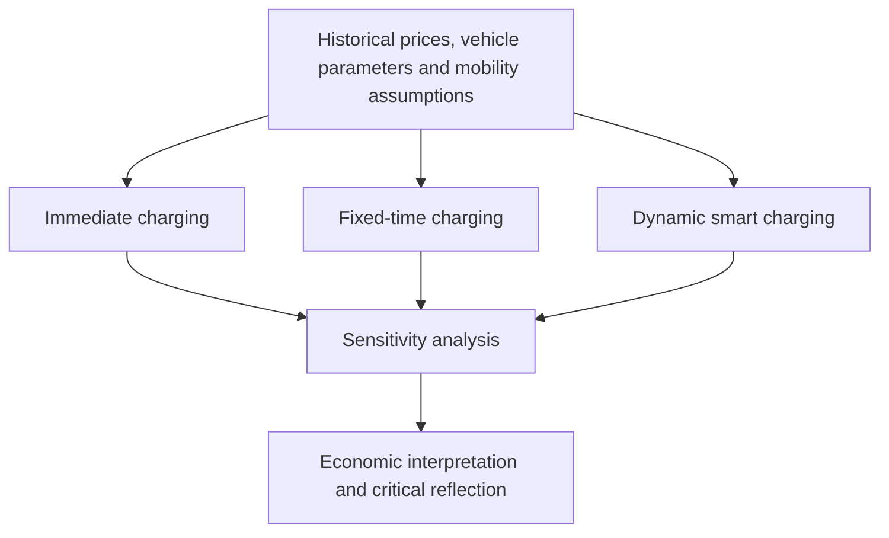

# The Economic Value of Smart EV Charging

*A Reflection on the Trade-Off Between Cost Savings and Consumer Flexibility*

> **Status:** Research protocol, not completed empirical research. All proposed parameters and data sources remain subject to verification. No simulation results have been generated yet.

## 1. Research question

**How does charging flexibility influence the economic benefits of smart electric vehicle charging, and what limits the realisation of these benefits in practice?**

The quantitative analysis focuses on market-driven optimisation, as distinguished from grid-conscious and prosumer-oriented optimisation by Pons-Seres de Brauwer and Loock (2026, pp. 1–2). The latter two dimensions inform the critical reflection rather than being explicitly modelled.

## 2. Research design

Conduct a retrospective simulation using observed electricity prices and a literature-calibrated hypothetical battery electric vehicle (BEV). Electricity prices are empirical observations; charging behaviour and cost savings are simulated, not observed household outcomes.

Hold vehicle characteristics and energy requirements constant across charging strategies. Investigate charging availability, seasonality and tariff structure. Interpret gross savings alongside consumer inconvenience, implementation costs and business model implications.

## 3. Data selection

| Dimension | Proposed specification |
|---|---|
| Market | Germany–Luxembourg bidding zone |
| Market type | Day-ahead electricity market |
| Observation period | 1 January–31 December 2025 |
| Model resolution | Hourly |
| Expected observations | 8,760 hourly intervals |
| Candidate sources | Bundesnetzagentur SMARD or Fraunhofer Energy-Charts |
| Original price unit | EUR/MWh |
| Simulation price unit | EUR/kWh |

Germany facilitates contextual comparison with Schuller et al. (2014), Lohr et al. (2025) and Gnann et al. (2025). The year 2025 provides a recent complete calendar year.

Convert EUR/MWh to EUR/kWh by dividing by 1,000. If the source contains quarter-hourly prices, aggregate to hourly prices using equal-duration averages. Hourly aggregation may understate the value of finer charging flexibility. Preserve timezone-aware timestamps and handle daylight-saving transitions explicitly. Obtain boundary-day prices if needed for overnight sessions.

## 4. Technical assumptions

Lohr et al. (2025, pp. 6–7) provide the principal reference specification.

| Parameter | Proposed value | Source / status |
|---|---:|---|
| Battery capacity | 45 kWh | Lohr et al. (2025), p. 6 |
| Maximum charging power | 11 kW | Lohr et al. (2025), p. 6 |
| Annual electricity consumption | 2,180 kWh | Lohr et al. (2025), p. 6; verify energy boundary |
| Annual driving distance | 10,442 km | Lohr et al. (2025), p. 6 |
| Charging efficiency | 95% | Derived from reported 5% losses; verify convention |
| Share of charging at home | 72% | Lohr et al. (2025), p. 6 |
| Reference departure time | 06:00 | Adapted from Lohr et al. (2025), p. 7 |
| Morning minimum state of charge | 60% | Lohr et al. (2025), p. 7 |
| Reference arrival time | 18:00 | Own scenario assumption |
| Bidirectional charging | Excluded | Research scope |

### Residential energy requirement

Preliminary calculation:

$$E_{home}=2,180\times0.72=1,569.6\text{ kWh/year}$$

$$E_{daily}=\frac{1,569.6}{365}\approx4.30\text{ kWh/day}$$

A constant daily energy requirement is a simplifying assumption, not an observed mobility profile. Before implementation, verify whether the 2,180 kWh figure already includes charging losses. If it represents grid energy, do not divide by efficiency again; if it represents battery energy, account for charging losses when calculating grid demand.

## 5. Charging strategies

All strategies must satisfy identical energy and mobility requirements and applicable technical constraints.

| Strategy | Rule |
|---|---|
| A — Immediate charging | Start charging upon connection at the available power until the required energy is delivered. |
| B — Fixed-time charging | Prefer charging from midnight, subject to availability and departure requirements. Use a documented fallback when midnight charging cannot deliver the required energy. |
| C — Dynamic smart charging | Allocate charging to the cheapest feasible intervals using day-ahead prices known when scheduling. |

The fixed-time comparison is motivated by Lyon et al. (2012), who examine whether more sophisticated charging strategies justify their additional costs compared with simpler time-of-use approaches. A fixed schedule is not itself a time-of-use tariff; the schedule and the tariff must be distinguished.

## 6. Mathematical optimisation model

### Objective

Minimise electricity expenditure:

$$\min C=\sum_{t=1}^{T}p_tq_t$$

| Symbol | Definition |
|---|---|
| $C$ | Total electricity expenditure (EUR) |
| $p_t$ | Electricity price in interval $t$ (EUR/kWh) |
| $q_t$ | Electricity drawn from the grid in interval $t$ (kWh) |
| $T$ | Number of modelled intervals |
| $P_{max}$ | Maximum charging power (kW) |
| $\Delta t$ | Interval duration (hours) |
| $a_t$ | Availability indicator (1 if connected; 0 otherwise) |
| $B_t$ | Stored battery energy (kWh) |
| $\eta$ | Charging efficiency |
| $d_t$ | Net battery energy withdrawal associated with mobility (kWh) |

### Constraints

**Charging power and availability**

$$0\leq q_t\leq P_{max}\Delta t\,a_t$$

**Battery energy balance**

$$B_{t+1}=B_t+\eta q_t-d_t$$

If charging outside the home is explicitly represented, include it as an exogenous battery energy input and avoid double-counting it in net withdrawals.

**Battery capacity**

$$0\leq B_t\leq45\text{ kWh}$$

**Morning mobility requirement**

$$B_{06:00}\geq0.60\times45=27\text{ kWh}$$

**Terminal battery condition**

$$B_{initial}=B_{final}$$

This prevents artificially reducing costs by depleting the battery. Schuller et al. (2014, p. 2016) use an equivalent terminal condition and assume mobility feasibility and price-taking behaviour.

### Implementation approach

Optimise over feasible charging sessions or rolling horizons, not with perfect knowledge of the full year's prices. Verify the publication timing of day-ahead prices against each scheduling decision. For a simple session with a fixed energy target, constant efficiency and no binding intermediate battery constraints, allocating energy to the cheapest available intervals is sufficient. Use linear programming if intertemporal battery constraints require it.

The precise initial state of charge, daily mobility withdrawals and session energy targets must be fixed before coding. A session-level simplification may be used if it preserves comparable energy delivery and mobility feasibility; document any departure from the full battery model.

## 7. Electricity tariff methodology

Wholesale prices are not equivalent to residential electricity prices.

| Tariff scenario | Specification | Purpose |
|---|---|---|
| Flat tariff | Constant price per kWh | Control scenario |
| Wholesale-only | Observed day-ahead prices | Isolate market-driven savings potential |
| Simplified dynamic residential tariff | Spot price plus constant per-kWh charges | Illustrate consumer expenditure |

$$p_t^{retail}=p_t^{spot}+k$$

Test illustrative values of $k$ equal to 0.10, 0.20 and 0.30 EUR/kWh. These are scenario assumptions, not verified commercial tariffs. A flat tariff level must also be specified before simulation.

When all strategies consume the same total grid energy $E$, the constant surcharge contributes $kE$ to each strategy. It therefore leaves absolute savings unchanged but reduces percentage savings when baseline costs are positive. Fixed subscription fees and time-varying network fees are not represented by this simple formula.

Report wholesale procurement savings separately from illustrative residential bill savings. Do not interpret negative wholesale prices as guaranteed negative household retail prices.

## 8. Sensitivity analysis

### Experiment A — Duration of charging availability

| Scenario | Available charging window | Duration |
|---|---|---:|
| F1 | 18:00–20:00 | 2 hours |
| F2 | 18:00–22:00 | 4 hours |
| F3 | 18:00–00:00 | 6 hours |
| F4 | 18:00–02:00 | 8 hours |
| F5 | 18:00–04:00 | 10 hours |
| F6 | 18:00–06:00 | 12 hours |

These are hypothetical nested charging windows, not observed driving patterns. The morning mobility requirement remains unchanged. Every scenario must be feasible for the required energy demand; report any infeasible cases instead of silently reducing energy delivery.

Annual savings:

$$S(f)=C_{immediate}-C_{smart}(f)$$

Average incremental annual value per extra hour of daily charging availability:

$$MV_f=\frac{S(f+2)-S(f)}{2}$$

Use a common immediate-charging baseline where feasible. Expanding a nested feasible set cannot increase the optimised cost under identical information and constraints. Diminishing marginal savings, however, are not guaranteed.

### Experiment B — Timing of availability

Compare equally long daytime and nighttime charging windows while maintaining identical energy requirements. Specify consistent mobility deadlines for each profile. Distinguish the effect of charging-window duration from the effect of access to particular price periods.

### Experiment C — Seasonality

Compare immediate, fixed-time and dynamic strategies across winter (December–February), spring (March–May), summer (June–August) and autumn (September–November). Define the allocation of overnight sessions to seasons consistently. Lohr et al. (2025, p. 5) discuss the shift in attractive charging periods between winter and summer.

## 9. Research hypotheses

| Hypothesis | Proposed expectation | Test |
|---|---|---|
| H1 | Dynamic optimisation reduces costs relative to immediate charging under time-variable prices. | Strategy comparison |
| H2 | Additional charging availability exhibits diminishing marginal economic value. | Incremental flexibility analysis |
| H3 | The incremental value of dynamic over fixed-time charging differs across seasons. | Seasonal comparison |

H1 is primarily a model validation and benchmarking exercise: with identical constraints and complete session price information, a cost-minimising schedule cannot cost more than a feasible alternative. H2 and H3 are empirical questions whose outcomes are not guaranteed. Do not change the hypotheses retrospectively to match the results.

## 10. Economic interpretation

Distinguish gross electricity savings from potential net consumer value:

$$V_{net}(f)=S(f)-D(f)-K(f)$$

- $S(f)$: electricity cost savings estimated by the simulation.
- $D(f)$: implicit consumer discomfort cost.
- $K(f)$: additional implementation or service costs.

Kubli, Loock and Wüstenhagen (2018) inform the behavioural discussion; Helms, Loock and Bohnsack (2016) inform the business model discussion. Do not directly subtract published discomfort estimates from simulated savings without establishing comparable flexibility definitions, currencies and economic contexts. The model does not estimate a numerical optimum for net consumer value.

Relevant literature benchmarks include Schuller et al. (2014, p. 2014), who report average charging cost reductions above 32% across their analysed cases; Lohr et al. (2025, section 3.1.1), whose day-ahead optimisation benchmark is distinct from intraday optimisation; and Gnann et al. (2025, p. 1), who find only small savings without solar power in their model. Differences in cost definitions, tariffs, years and mobility assumptions must be considered before comparing results.

## 11. Planned outputs

- Figure 1: Annual electricity expenditure by charging strategy.
- Figure 2: Annual savings as a function of charging availability, with incremental values where useful.
- Compact results table: absolute and relative savings, seasonal comparisons and incremental benefits of dynamic versus fixed-time charging.
- Supporting diagnostics: price profiles, data quality checks, energy balance and schedule feasibility.

Calculate absolute savings as baseline cost minus strategy cost. Calculate percentage savings as absolute savings divided by baseline cost, multiplied by 100; flag zero or negative baseline costs rather than presenting misleading percentages.

Include only the most informative outputs in the five-to-six-page reflection paper. No illustrative numerical results should be presented as empirical findings.

## 13. Limitations

The model does not measure actual consumer behaviour, forecast EV adoption, simulate local grid congestion, quantify emissions or model V2G. It treats one hypothetical EV as a price taker and cannot be extrapolated directly to mass adoption. Charging windows, mobility profiles and simplified tariff scenarios are own research design assumptions. Results are conditional on the selected year, market, energy requirements and model specification. The analysis estimates gross savings, not comprehensive welfare or net profitability. Literature comparisons must account for different study designs.

## 14. Core references

- Gnann, T., Yu, S., Stute, J., & Kühnbach, M. (2025). The value of smart charging at home and its impact on EV market shares – A German case study. *Applied Energy, 380*, 124997. https://doi.org/10.1016/j.apenergy.2024.124997
- Helms, T., Loock, M., & Bohnsack, R. (2016). Timing-based business models for flexibility creation in the electric power sector. *Energy Policy, 92*, 348–358. https://doi.org/10.1016/j.enpol.2016.02.036
- Kubli, M., Loock, M., & Wüstenhagen, R. (2018). The flexible prosumer: Measuring the willingness to co-create distributed flexibility. *Energy Policy, 114*, 540–548. https://doi.org/10.1016/j.enpol.2017.12.044
- Lohr, Eicke, & Hirth (2025). *Intelligentes Laden: Finanzielle Einsparpotentiale und Strommarkt-Erlöse durch flexibles und bidirektionales Laden von Elektroautos*. Neon Neue Energieökonomik. Supplied report; consult the literature evidence matrix and original PDF for full citation details.
- Lyon, T. P., Michelin, M., Jongejan, A., & Leahy, T. (2012). Is “smart charging” policy for electric vehicles worthwhile? *Energy Policy, 41*, 259–268. https://doi.org/10.1016/j.enpol.2011.10.045
- Pons-Seres de Brauwer, C., & Loock, M. (2026). The economics of smart EV charging at home: A review and research agenda. *npj Sustainable Mobility and Transport, 3*, 37. https://doi.org/10.1038/s44333-026-00105-4
- Schuller, A., Dietz, B., Flath, C. M., & Weinhardt, C. (2014). Charging strategies for battery electric vehicles: Economic benchmark and V2G potential. *IEEE Transactions on Power Systems, 29*(5). https://doi.org/10.1109/TPWRS.2014.2301024

Refer to the literature evidence matrix for supporting publications, detailed evidence and source locations.
